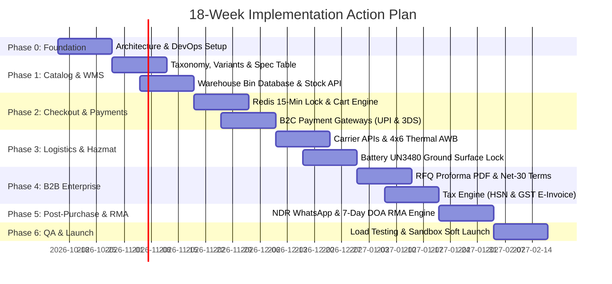
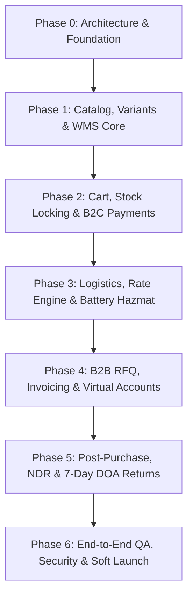

# Phase-by-Phase Implementation Action Plan
## Robotics Parts & Starter Kits E-Commerce Platform

---

### Document Overview
- **Project Name:** NextGen Robotics E-Commerce Platform
- **Document Version:** 1.0.0
- **Associated Documents:** 
  - [Robotics_Ecommerce_BRD.md (v2.0)](./Robotics_Ecommerce_BRD.md)
  - [Robotics_Ecommerce_PRD.md (v1.0)](./Robotics_Ecommerce_PRD.md)
- **Target Timeline:** 18 Weeks (9 Sprints of 2 weeks each)
- **Architecture Model:** Headless Commerce (Next.js 15 Frontend + Node.js / Medusa Core + PostgreSQL + Redis)

---

## 1. Master Implementation Roadmap

---

## 2. Phase-by-Phase Breakdown

---

### Phase 0: Technical Architecture, Infrastructure & DevOps Baseline
**Timeline:** Weeks 1–2 (Sprint 1)  
**Primary Goal:** Establish repository structure, database schemas, CI/CD pipelines, and cloud environments.

#### Key Workstreams & Tasks
1. **Repository Setup:**
   - [ ] Establish Monorepo structure (e.g., Turborepo) containing:
     - `apps/storefront` (Next.js 15 with React Server Components, Tailwind CSS, TypeScript).
     - `apps/b2b-portal` (Client dashboard for institutional procurement & RFQ tracking).
     - `apps/wms-operator` (PWA / Mobile web interface for warehouse barcode scanning).
     - `services/commerce-core` (Headless commerce backend / Node.js API).
     - `packages/shared-types` (Shared TypeScript interfaces for Products, Orders, Hazmat codes).
2. **Database & Infrastructure Provisioning:**
   - [ ] Deploy primary PostgreSQL instance with JSONB support for parametric specs.
   - [ ] Deploy managed Redis cluster for session handling, rate-limiting, and distributed inventory locks.
   - [ ] Set up staging and production environments on AWS / Vercel with automated GitHub Actions CI/CD.
3. **Database Migration Baseline:**
   - [ ] Execute initial database migrations according to the PRD Entity-Relationship Diagram (ERD).
   - [ ] Create seed scripts for taxonomy categories and standard HSN codes (`8501`, `8542`, `8504`, `8507`).

**Definition of Done (DoD):**
- Automated CI pipeline passes linting and builds across all monorepo workspaces.
- Staging database connected with automated migration scripts.

---

### Phase 1: Product Catalog, Parametric Variant Selector & WMS Inventory
**Timeline:** Weeks 3–5 (Sprint 2 & early Sprint 3)  
**Primary Goal:** Build the parametric hardware browsing experience and internal warehouse bin storage tracking.

#### Key Workstreams & Tasks
1. **Catalog & Parametric Product Engine:**
   - [ ] Implement hierarchical category routing (`/motors`, `/controllers`, `/sensors`, `/batteries`, `/kits`).
   - [ ] Build the dynamic attribute variant selector chip component (Voltage, RPM, Torque, Shaft profile).
   - [ ] Develop standardized engineering specification tables based on product categories.
   - [ ] Implement the starter kit "What's in the Box" itemized component breakdown component with linked spare parts.
2. **Direct Inventory & Warehouse Coordinate System:**
   - [ ] Implement warehouse coordinate model (`Zone - Aisle - Rack - Shelf - Bin`).
   - [ ] Create internal inventory ingestion APIs (`POST /api/v1/wms/inventory/receive`) for receiving stock batches.
   - [ ] Build real-time stock availability counters with safety stock buffers ($S_{\text{threshold}} = 2$).
   - [ ] Display real-time PDP status: `In Stock`, `Low Stock (Only X Left)`, or `Out of Stock`.

**Definition of Done (DoD):**
- Users can toggle variant chips on PDP and observe price, SKU, live stock, and spec table updates within $< 150\text{ ms}$.
- Warehouse staff can assign physical bin coordinates to any SKU.

---

### Phase 2: Cart, 15-Minute Concurrency Lock & B2C Payment Gateways
**Timeline:** Weeks 6–8 (Sprint 3 & Sprint 4)  
**Primary Goal:** Enable frictionless consumer purchasing with anti-overselling concurrency protection.

#### Key Workstreams & Tasks
1. **Cart & Distributed Concurrency Lock:**
   - [ ] Build shopping cart state management with persistent sessions.
   - [ ] Implement Redis distributed locks (`lock:sku:{sku_id}`) with a strict **15-minute Time-To-Live (TTL)** triggered upon entering checkout.
   - [ ] Implement automatic lock release on checkout cancellation or timer expiry.
   - [ ] Implement atomic lock-to-permanent stock deduction conversion upon payment confirmation.
2. **B2C Digital Payment Integrations:**
   - [ ] Integrate UPI 2.0 gateway:
     - Dynamic UPI QR generator for desktop screens.
     - Mobile UPI Intent flow (Google Pay, PhonePe, Paytm, BHIM, Cred).
   - [ ] Integrate Credit/Debit Card gateway with 3DS2 OTP verification and network tokenization.
   - [ ] Integrate Net Banking support across major domestic retail banks.
3. **Webhook Reconciliation & Idempotency:**
   - [ ] Build signed server-to-server webhook ingestion endpoint (`POST /api/v1/payments/webhooks`).
   - [ ] Verify HMAC-SHA256 signatures against gateway secret keys.
   - [ ] Implement idempotency checks using unique `gateway_transaction_id` to prevent double-charging or duplicate order fulfillment.

**Definition of Done (DoD):**
- Stress tests confirm two concurrent users attempting to buy the last single unit cannot both complete checkout.
- End-to-end UPI and card transactions successfully transition orders to `PAID` state via asynchronous webhooks.

---

### Phase 3: Logistics, Rate Engine & Hazardous Battery Compliance
**Timeline:** Weeks 9–11 (Sprint 5 & early Sprint 6)  
**Primary Goal:** Automate warehouse dispatch workflows, shipping rate estimation, and mandatory ground shipping for batteries.

#### Key Workstreams & Tasks
1. **Volumetric Shipping & Pincode Serviceability Engine:**
   - [ ] Build physical dimensions ($L \times W \times H$) and dead weight metadata tracking on all variants.
   - [ ] Implement the billable volumetric weight calculator:
     $$W_{\text{billable}} = \max\left(\text{Weight}_{\text{dead}}, \; \frac{L \times W \times H}{5000} \times 1000\right)$$
   - [ ] Integrate courier serviceability APIs to check coverage and compute delivery date estimates (EDD).
2. **Hazardous Battery Ground Transport Compliance:**
   - [ ] Tag all battery SKUs with `UN3480` (standalone) or `UN3481` (in equipment) classifications.
   - [ ] Build enforcement logic: When any cart item contains a Lithium battery, automatically **lock out all Air Express couriers** and restrict options strictly to **Surface / Ground Logistics**.
   - [ ] Display an advisory banner on Cart and Checkout notifying the customer of ground transportation safety regulations.
3. **Warehouse Packing Station & Barcode Scanner App:**
   - [ ] Develop dedicated web app for packing stations (`apps/wms-operator`).
   - [ ] Implement barcode scan verification: Picker scans each physical item barcode; system flags mismatched SKUs with high-priority audio/visual alerts.
   - [ ] Implement automated Air Waybill (AWB) generation via courier API and print 4x6 inch thermal shipping labels.
   - [ ] Automatically print mandatory Lithium Battery Warning Marks and emergency contact labels on parcels carrying batteries.

**Definition of Done (DoD):**
- Any order containing LiPo or Li-Ion batteries is programmatically prevented from selecting air couriers.
- Thermal shipping labels and carrier manifests print with valid tracking AWBs within $< 2\text{ seconds}$ of packing completion.

---

### Phase 4: B2B Enterprise Workflows, RFQ Engine & Statutory Tax Compliance
**Timeline:** Weeks 12–14 (Sprint 6 & Sprint 7)  
**Primary Goal:** Provide university labs, research institutions, and robotics startups with enterprise procurement tools.

#### Key Workstreams & Tasks
1. **B2B Account Management & Tax Validation:**
   - [ ] Build corporate account registration flow with tax identification (GSTIN) verification.
   - [ ] Implement automated regex and government API validation for active tax registration.
2. **Request for Quote (RFQ) & Proforma Invoicing:**
   - [ ] Build the "Request Formal Quotation" checkout path for carts $\ge \$250$ or $\ge 10$ units.
   - [ ] Implement dynamic PDF generation for Proforma Invoices featuring:
     - 14-day price lock guarantee timestamp.
     - Itemized HSN codes (`8501`, `8542`, `8504`, `8507`) and tax split (CGST + SGST vs. IGST).
     - Dedicated bank remittance instructions.
3. **Purchase Order (PO) & Net-30 Credit Workflows:**
   - [ ] Build institutional Purchase Order (PO) PDF upload portal.
   - [ ] Implement admin credit line manager to grant verified institutions Net-15, Net-30, or Net-60 payment terms.
   - [ ] Orders within approved credit limits bypass upfront payment and dispatch immediately.
4. **Offline Wire Settlement (Virtual Accounts):**
   - [ ] Integrate Bank Virtual Accounts (VANs) assigning unique account numbers to institutional clients.
   - [ ] Ingest bank credit webhooks to automatically reconcile NEFT/RTGS payments against open Proforma Invoices.

**Definition of Done (DoD):**
- A university buyer can generate a formal PDF Proforma Invoice in $< 5\text{ seconds}$ without making an upfront credit card payment.
- Invoices correctly apply state-based tax splits and statutory HSN codes.

---

### Phase 5: Post-Purchase Milestones, NDR Resolution & 7-Day DOA Returns
**Timeline:** Weeks 15–16 (Sprint 8)  
**Primary Goal:** Streamline post-delivery customer experience, delivery exception management, and warranty claims.

#### Key Workstreams & Tasks
1. **Live Courier Milestone Tracking:**
   - [ ] Ingest courier tracking webhooks: `Manifested` $\rightarrow$ `In Transit` $\rightarrow$ `Out for Delivery` $\rightarrow$ `Delivered`.
   - [ ] Dispatch automated SMS / WhatsApp tracking updates with live map links.
2. **Automated NDR (Non-Delivery Report) Resolution:**
   - [ ] Listen for courier delivery failure webhooks (e.g., customer unavailable, incorrect address).
   - [ ] Trigger automated WhatsApp / SMS messages within 15 minutes offering interactive options:
     - Confirm / Update Delivery Address.
     - Reschedule for next business day.
   - [ ] Push customer response directly back to the carrier API for the next delivery attempt.
3. **7-Day Dead on Arrival (DOA) RMA Engine:**
   - [ ] Lock return ticket generation to within 7 calendar days of the `DELIVERED` milestone timestamp.
   - [ ] Build RMA customer portal requiring:
     - Return reason selection.
     - Mandatory high-resolution photo upload of wiring/soldering.
     - Optional short video proof of power failure.
   - [ ] Build internal engineering review dashboard to approve replacement shipments or store credit refunds.

**Definition of Done (DoD):**
- Delivery exceptions automatically notify customers and feed reschedule instructions back into courier APIs.
- Defective component claims flow smoothly through the 7-day DOA RMA portal with complete photo documentation.

---

### Phase 6: End-to-End QA, Security Audits & Soft Launch
**Timeline:** Weeks 17–18 (Sprint 9)  
**Primary Goal:** Validate system performance, conduct security audits, and perform a controlled production soft launch.

#### Key Workstreams & Tasks
1. **Load Testing & Concurrency Validation:**
   - [ ] Execute Locust / k6 load tests simulating 2,000 concurrent active users and high-velocity flash sales.
   - [ ] Validate Redis distributed locking performance under high contention (0 overselling occurrences).
2. **Security & Vulnerability Assessment (VAPT):**
   - [ ] Enforce HTTPS TLS 1.3 across all domains.
   - [ ] Audit role-based access control (RBAC) separating customers, warehouse staff, finance admins, and super admins.
   - [ ] Verify zero raw payment data storage and validate PCI-DSS compliance.
3. **Live Logistics & Battery Test Run:**
   - [ ] Execute physical test orders through the warehouse packing station with real barcode scanners.
   - [ ] Dispatch test battery orders with surface courier partners to verify zero customs/ground inspection delays.
4. **Soft Launch & Controlled Rollout:**
   - [ ] Onboard pilot group of university robotics clubs and hardware makers.
   - [ ] Collect initial feedback on checkout speed, packaging quality, and quotation turnaround.

**Definition of Done (DoD):**
- System passes penetration testing and security review without critical vulnerabilities.
- Production environment successfully processes end-to-end live orders from placement to courier handover within the 24-hour SLA.

---

## 3. Team Allocation & Responsibility Matrix (RACI)

| Phase | Frontend Lead | Backend / API Lead | WMS / Ops Lead | QA & Security | Product Manager |
| :--- | :---: | :---: | :---: | :---: | :---: |
| **Phase 0: Architecture & DevOps** | C | **A / R** | I | R | C |
| **Phase 1: Catalog & WMS Core** | **A / R** | R | R | R | C |
| **Phase 2: Checkout & Payments** | R | **A / R** | I | R | C |
| **Phase 3: Logistics & Hazmat** | R | R | **A / R** | R | C |
| **Phase 4: B2B RFQ & Invoicing** | R | **A / R** | I | R | C |
| **Phase 5: Post-Purchase & RMA** | R | R | R | R | **A / R** |
| **Phase 6: QA, VAPT & Launch** | R | R | R | **A / R** | **A** |

*Legend: **A** = Accountable, **R** = Responsible, **C** = Consulted, **I** = Informed.*

---

## 4. Key Risk Management Matrix

| Risk Event | Severity | Probability | Mitigation Strategy Codified in Plan |
| :--- | :---: | :---: | :--- |
| **Air cargo impounding of Lithium batteries** | Critical | High | Automatic programmatic lockout of air express in Phase 3 whenever cart contains `UN3480`/`UN3481` SKUs. Surface-only ground logistics enforced. |
| **Overselling due to concurrent checkouts** | High | Medium | Redis distributed lock (`15-minute TTL`) implemented in Phase 2; stock deducted atomically before gateway confirmation. |
| **High RTO due to incorrect addresses** | Medium | High | Pincode serviceability validation at checkout + automated WhatsApp NDR address correction workflow in Phase 5. |
| **Component damage due to customer misuse** | High | High | Strict 7-day DOA policy in Phase 5 requiring mandatory wiring photo/video upload before RMA authorization. |
| **Delayed payment reconciliation for B2B wires** | Medium | Medium | Bank Virtual Accounts (VAN) integrated in Phase 4 for automatic UTR and wire matching. |
