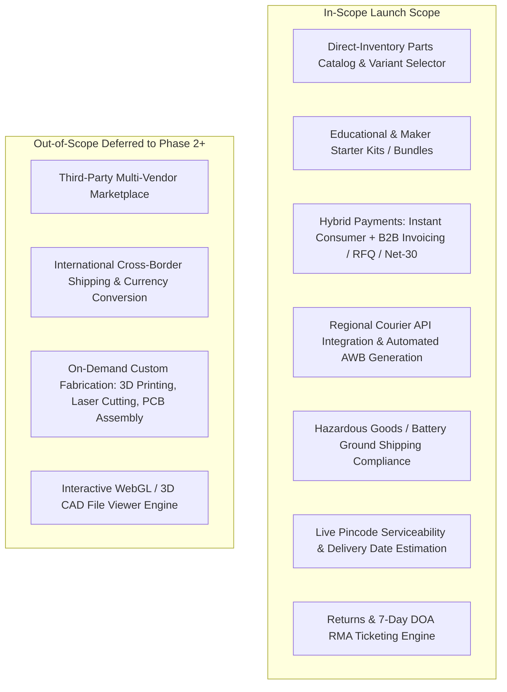
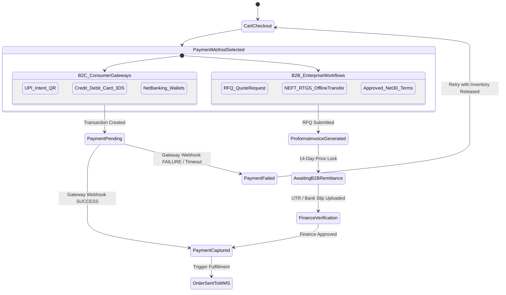
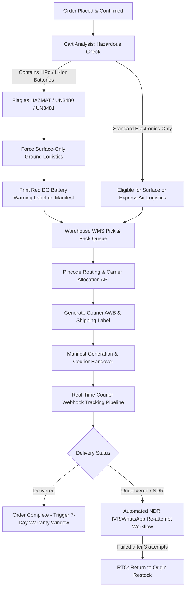
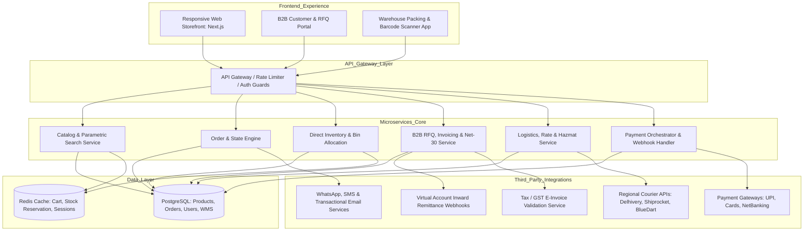

# Business Requirements Document (BRD)
## Robotics Parts & Kits E-Commerce Platform

---

### Document Control
- **Project Title:** Robotics Components & Starter Kits Direct-Commerce Platform
- **Document Version:** 2.0.0
- **Document Status:** Complete / Architectural Baseline
- **Created Date:** October 12, 2026
- **Target Geography:** Regional / Domestic Market
- **Authors & Contributors:** Product Management & Technical Architecture Group

---

## 1. Executive Summary & Vision

### 1.1 Project Overview
This Business Requirements Document (BRD) specifies the operational, technical, financial, and logistical requirements for building a regional robotics parts e-commerce platform. The platform operates on a **direct inventory model**, carrying physical stock in a centralized fulfillment warehouse to ensure 100% stock accuracy and guaranteed dispatch lead times.

### 1.2 Core Problem Statement
Robotics builders (ranging from STEM students and hobbyists to university research labs and commercial automation startups) face distinct friction points in standard electronics marketplaces:
1. **Unreliable Inventory & Long Delays:** High rate of order cancellations caused by drop-shippers and unverified stock.
2. **Incompatible Payment & Invoicing Workflows:** Inability for academic and corporate entities to place orders via Request for Quote (RFQ), Purchase Orders (PO), and formal tax invoices (with input credit).
3. **Logistics & Battery Bottlenecks:** Rejection or impounding of parcels containing high-discharge Lithium Polymer (LiPo) or Lithium-Ion (18650) batteries due to non-compliant transport classification.
4. **Lack of Technical Parametric Data:** Ambiguous variant data (e.g., motor shaft profiles, stall current vs. operating voltage, pinout documentation).

### 1.3 Key Performance Indicators (KPIs)
| KPI Category | Target Metric | Measurement Frequency |
| :--- | :--- | :--- |
| **Catalog Accuracy** | $\ge 99.8\%$ matching physical shelf inventory | Daily automated cycle count audit |
| **Dispatch SLA** | $100\%$ orders dispatched within 24 hours of confirmation | Order dispatch timestamp vs. payment capture |
| **Payment Success Rate** | $\ge 96\%$ across instant digital gateways | Real-time payment gateway monitoring |
| **B2B RFQ Turnaround** | Formal quote issued within $< 2$ hours during business hours | Sales CRM ticket timestamp |
| **RTO (Return to Origin) Rate** | $< 3\%$ of shipped packages | Courier post-delivery settlement report |
| **Hazmat Compliance** | $0$ carrier penalties / ground impounds for battery items | Quarterly carrier compliance audits |

---

## 2. Scope & Target Personas

### 2.1 Scope Definition

### 2.2 Target Customer Profiles

| Segment | Primary Persona | Key Purchasing Triggers | Critical Requirements |
| :--- | :--- | :--- | :--- |
| **B2C: Hobbyist / DIY Maker** | College robotics student, combat robot builder, drone hobbyist | Urgency before project/hackathon deadlines; complete starter kits | Instant payment (UPI, Cards), live stock counter, 24h dispatch |
| **B2B: Academic & Research Labs** | University professor, laboratory purchasing officer | Multi-item bill of materials (BOM); institutional grant funding | Formal PDF quotation, PO approval workflow, formal tax invoices |
| **B2B: Commercial Robotics OEMs** | Hardware engineer, procurement manager at automation startup | Sourcing 20–100 units of motors, sensors, and controllers | Volume pricing tiers, Net-30 payment terms, consistent batch specs |
| **Internal Operations** | Warehouse supervisor, fulfillment staff | Avoiding overselling; fast pick-and-pack | Barcode scanning, bin locations, carrier label printing |

---

## 3. Product Catalog & Taxonomy Requirements

### 3.1 Category Taxonomy
The platform shall structure products into the following structured taxonomy:
1. **Actuators & Motors:**
   - DC Brushed Gear Motors (Planetary, Spur, Worm)
   - Stepper Motors (NEMA 17, NEMA 23, Closed Loop)
   - Servo Motors (Micro 9g, Standard 180°/360°, High-Torque Metal Gear)
   - Brushless DC (BLDC) Motors & Drone Outrunners
   - Linear Actuators & Solenoids
2. **Motor Drivers & Controllers:**
   - Single & Dual H-Bridge Drivers (L298N, TB6612FNG, Cytron-style high-current)
   - Stepper Drivers (A4988, TMC2209, TB6600)
   - Electronic Speed Controllers (ESCs for BLDC & DShot)
3. **Microcontrollers & Edge Compute:**
   - Microcontroller Boards (ESP32 series, Arduino-compatible, STM32, Raspberry Pi Pico)
   - Single Board Computers (Raspberry Pi 4/5, Jetson Nano/Orin boards)
   - Sensor Shields & Expansion Hats
4. **Sensors & Perception Modules:**
   - Distance/Ranging: ToF LiDAR, Ultrasonic (HC-SR04), Infrared Obstacle
   - Inertial: IMUs (MPU6050, BNO055, 9-DOF Gyro/Accel/Mag)
   - Encoders: Optical, Magnetic Hall Effect
   - Environmental & Vision: Camera modules (MIPI CSI, USB), Line Tracking Arrays
5. **Power, Batteries & Protection:**
   - Rechargeable Lithium Batteries (LiPo 2S–6S packs, 18650/21700 cells)
   - Battery Management Systems (BMS) & Protection Circuit Modules (PCM)
   - DC-DC Step-Down (Buck) and Step-Up (Boost) Regulators
   - Connectors & Power Distribution (XT30, XT60, XT90, JST, PDB boards)
6. **Mechanical & Hardware Components:**
   - Wheels: Omni-directional, Mecanum, Rubber Grip, Castors
   - Chassis: Aluminum framing, acrylic plates, tracks, suspension systems
   - Hardware: Couplers, Flange shafts, Standoffs, Fasteners, Bearings
7. **Bundles & Starter Kits:**
   - Educational STEM Robotics Kits
   - Autonomous Wheeled Rover Kits
   - Drone Quadcopter Kits (without pre-assembled soldering)
   - Multi-DOF Robotic Arm Kits

### 3.2 Product Detail Page (PDP) Functional Specifications
- **FR-CAT-01 (Parametric Variants):** Support attribute-driven variant matrices (e.g., motor RPM: 60/100/300/600; operating voltage: 12V/24V; shaft type: D-cut/Keyway). Changing a variant updates the price, SKU, live stock count, and spec table instantly without full page refresh.
- **FR-CAT-02 (Standardized Technical Spec Table):** Every electronic/mechanical component must present structured parametric fields:
  - Rated Voltage & Operating Voltage Range
  - No-load Speed & No-load Current
  - Stall Torque & Stall Current
  - Weight, Shaft Diameter, Overall Dimensions
  - Pinout configuration / connector interface
- **FR-CAT-03 (Kit Component Breakdown):** Kit product pages must list an interactive "Items Included" component table with links to individual replacement parts.

---

## 4. Comprehensive Payments & Financial Workflows

### 4.1 B2C Instant Digital Payments

#### 4.1.1 Supported Payment Methods
- **FR-PAY-01 (UPI 2.0 Integration):** Support both Desktop Dynamic QR Code generation and Mobile UPI Intent (seamless app switching to Google Pay, PhonePe, Paytm, BHIM).
- **FR-PAY-02 (Card Processing & 3D Secure):** Support Domestic Credit & Debit Cards (Visa, MasterCard, RuPay). Strict compliance with two-factor authentication (OTP / 3DS2).
- **FR-PAY-03 (Net Banking & Digital Wallets):** Direct server-to-server integration covering major domestic commercial banks.
- **FR-PAY-04 (Tokenization & PCI Compliance):** Zero raw card number or CVV retention on merchant servers. Customer card storage must leverage RBI/PCI-DSS compliant network tokenization.

#### 4.1.2 Payment Lifecycle, Webhooks & Idempotency
- **FR-PAY-05 (Asynchronous Webhook Engine):** All order confirmations must rely on signed server-to-server webhooks rather than client-side browser redirects to prevent dropped orders when users close their browser window prematurely.
- **FR-PAY-06 (Idempotent Webhook Processing):** The payment callback handler must check whether the `payment_id` has already been processed to prevent double-crediting or duplicate order creation.
- **FR-PAY-07 (Inventory Holding Buffer):** When a user enters the payment gateway modal, stock for the cart items is reserved for a strict **15-minute window**. If no positive webhook arrives within 15 minutes, the reservation expires and the stock is unlocked for other buyers.
- **FR-PAY-08 (Refund Automation):**
  - Order cancellation before warehouse packing triggers an automated instant API refund to the original payment source.
  - Return/RMA approvals allow the customer to choose between direct bank refund (processed within 3–5 banking days) or instant Store Credit wallet points.

---

### 4.2 B2B Enterprise & Institutional Purchasing Workflows

#### 4.2.1 Request for Quote (RFQ) & Proforma Invoicing
- **FR-B2B-01 (RFQ Initiation):** Registered business accounts or orders with total value $\ge \$250$ (or quantity $\ge 10$ units) can choose **"Generate Formal Quotation"** at checkout.
- **FR-B2B-02 (Automated Proforma Quotation PDF):** System generates a downloadable, digitally signed Proforma Invoice containing:
  - System Quotation Reference Number (e.g., `RFQ-2026-XXXX`).
  - Company Legal Entity Name, Corporate Identification, and Tax ID (GSTIN/VAT).
  - Itemized HSN/SAC codes, base prices, quantity break discounts, and applicable tax rates.
  - Bank Account Wire Details (Beneficiary Name, Virtual Account Number, IFSC/BIC Code).
  - 14-Day Price & Stock Commitment validity window.

#### 4.2.2 Purchase Order (PO) & Net-30 Terms
- **FR-B2B-03 (Institutional PO Upload):** Approved institutional clients (educational institutions, vetted corporate accounts) can submit orders by attaching an authorized Purchase Order (PDF) and entering an internal PO reference number.
- **FR-B2B-04 (Net-30 Credit Management):**
  - Admins can assign individual credit limits (e.g., \$5,000) and credit terms (Net-15, Net-30, Net-60) to verified business accounts.
  - If an order is placed within the available credit limit, the order automatically bypasses upfront payment and is released directly to the warehouse queue.
  - Automated ledger tracking alerts the client at 7 days, 3 days, and on the due date for outstanding remittance.

#### 4.2.3 Offline Wire Transfer (NEFT/RTGS/IMPS) Settlement
- **FR-B2B-05 (UTR Reference Submission):** Clients paying via bank transfer can input their transaction UTR (Unique Transaction Reference) number and upload a payment receipt in their B2B portal.
- **FR-B2B-06 (Virtual Account Auto-Reconciliation):** Integrate bank virtual accounts (VANs) where each customer or quote has a unique beneficiary account number. Inward wire credits automatically reconcile and release orders into fulfillment without manual manual finance intervention.

#### 4.2.4 Statutory Tax & Invoicing Compliance
- **FR-TAX-01 (HSN Code Cataloging):** Every SKU in the database must carry its statutory HSN (Harmonized System of Nomenclature) code (e.g., `8501` for Electric Motors, `8542` for Electronic Integrated Circuits/Microcontrollers, `8504` for Power Supplies, `8507` for Lithium Accumulators).
- **FR-TAX-02 (Tax Splitting):** Tax engine must compute proper jurisdictional taxes (e.g., Intrastate CGST + SGST vs. Interstate IGST) based on the warehouse dispatch state vs. buyer shipping state.
- **FR-TAX-03 (B2B E-Invoicing):** For applicable institutional orders, automatically generate government-compliant IRN (Invoice Reference Number) and signed QR code on finalized invoices.

---

## 5. Comprehensive Logistics, Shipping & Hazardous Goods

### 5.1 Serviceability & Delivery Date Engine
- **FR-LOG-01 (Pincode / Postal Code Serviceability Checker):** Every product page and cart page must include a real-time pincode checker that verifies:
  - Carrier delivery coverage.
  - Expected delivery turnaround time (EDD in business days).
  - Cash on Delivery (COD) availability (if applicable).
  - Hazmat / Battery serviceability (verifying ground carrier reachability).
- **FR-LOG-02 (Cut-off Time & Same-Day Dispatch SLA):** Orders received and paid prior to **2:00 PM** on business days must receive a system flag for **Same-Day Dispatch**. Orders after 2:00 PM are scheduled for Next Business Day dispatch.

---

### 5.2 Hazardous Goods (HAZMAT) & Battery Transport Compliance

Robotics projects rely heavily on high-energy-density power systems. Mishandling battery transport creates fire hazards and legal impoundment risks. The platform must implement strict automated compliance rules:

#### 5.2.1 Classification & Tagging
- **FR-HAZ-01 (Battery SKU Categorization):** All battery products must be flagged with explicit transport classifications:
  - **UN3480:** Lithium-Ion / LiPo cells or battery packs shipped alone.
  - **UN3481:** Lithium-Ion batteries packed with or contained in equipment/robot kits.
- **FR-HAZ-02 (Watt-Hour Limit Check):** High-capacity battery packs exceeding specific watt-hour thresholds ($>100\text{ Wh}$) must trigger special heavy packaging handling rules and cannot be combined with standard consumer parcel rates.

#### 5.2.2 Surface-Only Logistics Enforcement
- **FR-HAZ-03 (Express Air Lockdown):** If a customer cart contains any SKU tagged as `UN3480` or `UN3481`, the shipping rate calculator must **strictly disable Air Cargo / Express Air options** and force **Surface Logistics (Ground Transport)**.
- **FR-HAZ-04 (Hazardous Warning Packing Slips):** The warehouse packing station software must automatically print an official **Lithium Battery Mark (UN3480/UN3481)** with emergency telephone contact details directly alongside the shipping label.
- **FR-HAZ-05 (Protective Packaging Mandates):** Battery packing SOPs require terminal insulation (heat-shrink caps or protective tape) and anti-static, impact-resistant inner bubble sleeves, codified into warehouse packing checklists.

---

### 5.3 Shipping Rate Calculation Engine
- **FR-LOG-03 (Volumetric vs. Dead Weight Calculation):**
  Courier charges are computed on billable weight, which is the greater of actual physical weight or volumetric weight:
  $$\text{Volumetric Weight (kg)} = \frac{\text{Length (cm)} \times \text{Width (cm)} \times \text{Height (cm)}}{5000}$$
  Every product record must store physical dimensions ($L \times W \times H$) and dead weight. For multi-item carts, a 3D box packing algorithm estimates final carton dimensions to calculate exact carrier rates at checkout.
- **FR-LOG-04 (Free Shipping Tiers):** Configurable minimum cart threshold (e.g., Free Shipping on domestic orders $\ge \$75$, excluding bulk battery shipments or oversized aluminum chassis).

---

### 5.4 Warehouse Fulfillment & Courier Integration (WMS)
- **FR-LOG-05 (Multi-Carrier API Aggregation):** Direct integration with primary regional couriers or logistics aggregators (e.g., Delhivery, Shiprocket, BlueDart) to dynamically assign the lowest-cost, highest-reliability carrier per destination pincode.
- **FR-LOG-06 (Automated AWB & Shipping Label Generation):** When an order enters the `PACKED` state in the warehouse portal, the system triggers the carrier API, retrieves the Air Waybill (AWB) number, and prints standard 4x6 inch thermal barcode labels.
- **FR-LOG-07 (Daily Manifest Handover):** Generate digital and printable carrier manifests grouping all packages dispatched during the evening courier pickup with driver signature acknowledgement.

---

### 5.5 Post-Dispatch Tracking, NDR & RTO Management
- **FR-LOG-08 (Milestone Tracking Webhooks):** Real-time webhook ingestion updating customer order status:
  1. `Manifested / Picked Up`
  2. `In Transit (Hub Arrival / Departure)`
  3. `Out for Delivery`
  4. `Delivered`
  5. `Undelivered / NDR (Non-Delivery Report)`
- **FR-LOG-09 (Automated NDR Resolution Workflow):**
  When a delivery attempt fails (e.g., "Customer Not Available", "Incomplete Address"):
  - System sends automated WhatsApp/SMS notifications with a secure link allowing the customer to confirm their delivery address or reschedule the delivery date.
  - Customer response is fed directly back into the courier API for the next attempt.
- **FR-LOG-10 (RTO Processing):** If 3 delivery attempts fail and the parcel returns to the warehouse (Return to Origin):
  - Warehouse performs a restock scan verifying sealed box condition.
  - Return shipping charges are deducted if applicable, and net balance is refunded or credited.

---

## 6. Inventory & Warehouse Management System (WMS)

- **FR-WMS-01 (Direct Inventory Exclusivity):** Zero drop-shipping on launch catalog. Items listed online must exist physically within the fulfillment center.
- **FR-WMS-02 (Bin Location Mapping):** Every SKU in the warehouse is mapped to a hierarchical physical coordinate: `Zone - Aisle - Rack - Shelf - Bin` (e.g., `Z1-A03-R02-S1-B04`).
- **FR-WMS-03 (Pick-List Batching):** Pick lists group multiple customer orders into a single optimized travel path through warehouse aisles to maximize picker efficiency.
- **FR-WMS-04 (Barcode Verification at Packing):** Handheld barcode scanners must verify every picked item against the order manifest before sealing the box, preventing wrong-item shipments.
- **FR-WMS-05 (Cycle Counting & Reorder Thresholds):** Configurable minimum safety stock alerts notify the procurement team when inventory drops below expected weekly velocity.

---

## 7. Customer Support, Technical Warranty & Returns (RMA)

Robotics electronics require specialized return policies to mitigate customer error (e.g., connecting motors without flyback diodes, reverse polarity damage, or ESD static discharge).

- **FR-RMA-01 (7-Day Dead on Arrival / DOA Window):** Electronic components (microcontrollers, motor drivers, sensors, ICs) carry a strict **7-day DOA inspection window** from the carrier delivery timestamp.
- **FR-RMA-02 (Technical Return Evidence):** Customers claiming defect must submit a ticket via the RMA portal with:
  - High-resolution photograph of the solder joints/wiring connections.
  - Brief video demonstrating power-up failure or defect behavior.
- **FR-RMA-03 (Warranty Exclusion Criteria):** Clear policy stating that components showing obvious physical burns, blown MOSFETs due to short circuits, over-voltage input, or soldered headers that caused thermal damage are excluded from returns.
- **FR-RMA-04 (Restocking & Replacement Dispatch):** Once approved by the engineering support team, the warehouse dispatches an immediate replacement unit with prepaid return label collection for the defective item.

---

## 8. Non-Functional Requirements (NFRs)

### 8.1 Performance & Latency
- **NFR-01:** Web storefront homepage and product catalog response time $\le 1.5\text{ seconds}$ (Core Web Vitals LCP $< 2.5\text{s}$).
- **NFR-02:** Live inventory check API latency $\le 100\text{ ms}$ under concurrent load.
- **NFR-03:** Capable of handling $\ge 2,000$ concurrent active users during peak robotics festival or seasonal academic events.

### 8.2 Security, Privacy & Integrity
- **NFR-04:** Enforce HTTPS TLS 1.3 across all endpoints.
- **NFR-05:** End-to-end webhook cryptographic signature verification (HMAC SHA-256) for payment and logistics gateway callbacks.
- **NFR-06:** Strict Role-Based Access Control (RBAC):
  - *Customer:* Own cart, orders, quotes.
  - *Warehouse Operator:* Packing queues, bin locations, AWB printing.
  - *Finance / Accounts:* B2B credit approval, invoice generation, reconciliation.
  - *Super Admin:* Full system control, price overriding.

### 8.3 Reliability & Availability
- **NFR-07:** Service availability of **99.9%** (less than 8.7 hours downtime per year).
- **NFR-08:** Automated off-site database backups every 6 hours with automated failover capabilities.

---

## 9. Comprehensive System Architecture

---

## 10. Implementation Phases & Milestones

| Milestone | Target Duration | Key Deliverables |
| :--- | :--- | :--- |
| **Phase 1: Catalog & Core WMS** | Weeks 1–4 | Database schema, inventory tracking, bin coordinates, product taxonomy, and parametric spec tables. |
| **Phase 2: Payments & Retail Checkout** | Weeks 5–8 | Instant digital payments (UPI intent, cards, net banking), stock reservation lock (15m), and webhook reconciliation engine. |
| **Phase 3: Logistics & Hazmat Engine** | Weeks 9–12 | Courier API integration, automated AWB printing, volumetric calculation, battery UN3480/UN3481 surface routing. |
| **Phase 4: B2B RFQ & Net-30 Workflows** | Weeks 13–16 | Proforma invoice PDF generator, PO upload, tax validation (GSTIN/HSN codes), and virtual account auto-reconciliation. |
| **Phase 5: Quality Assurance & Launch** | Weeks 17–18 | End-to-end stress testing, carrier sandbox pickup testing, DOA/RMA testing, and live soft launch. |

---

## 11. Approval & Governance Sign-Off

| Stakeholder Role | Name / Title | Signature / Status | Date |
| :--- | :--- | :--- | :--- |
| **Lead Product Manager** | ____________________ | Approved | Oct 12, 2026 |
| **Head of Logistics & Supply Chain** | ____________________ | Approved | Oct 12, 2026 |
| **Head of Finance & Compliance** | ____________________ | Approved | Oct 12, 2026 |
| **Principal Software Architect** | ____________________ | Approved | Oct 12, 2026 |
