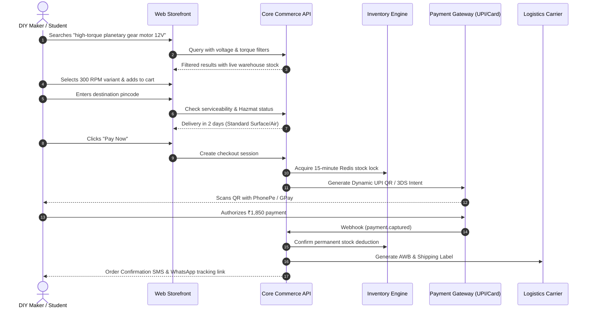
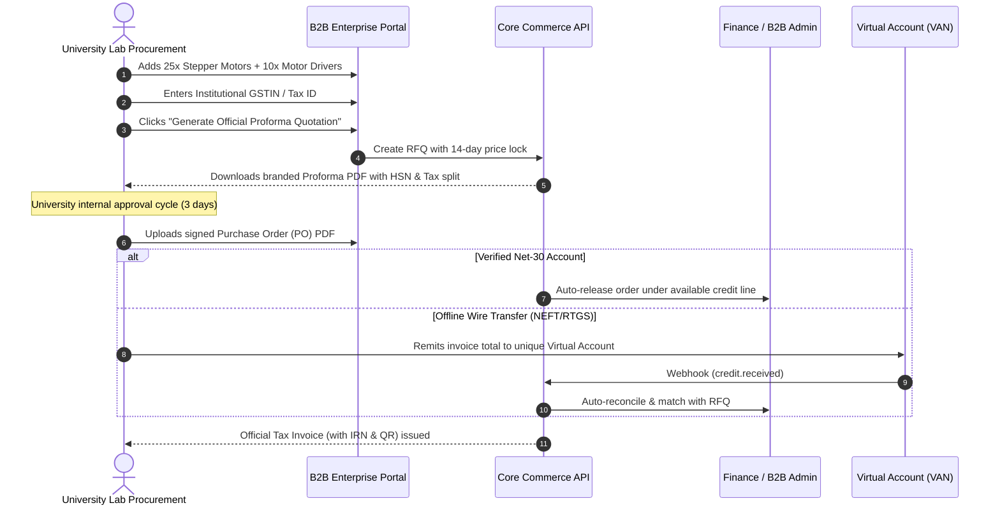
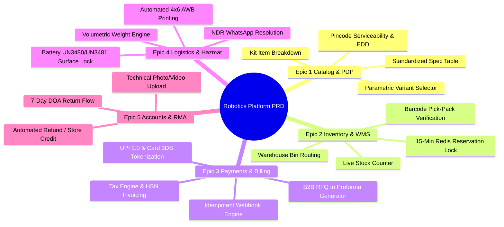
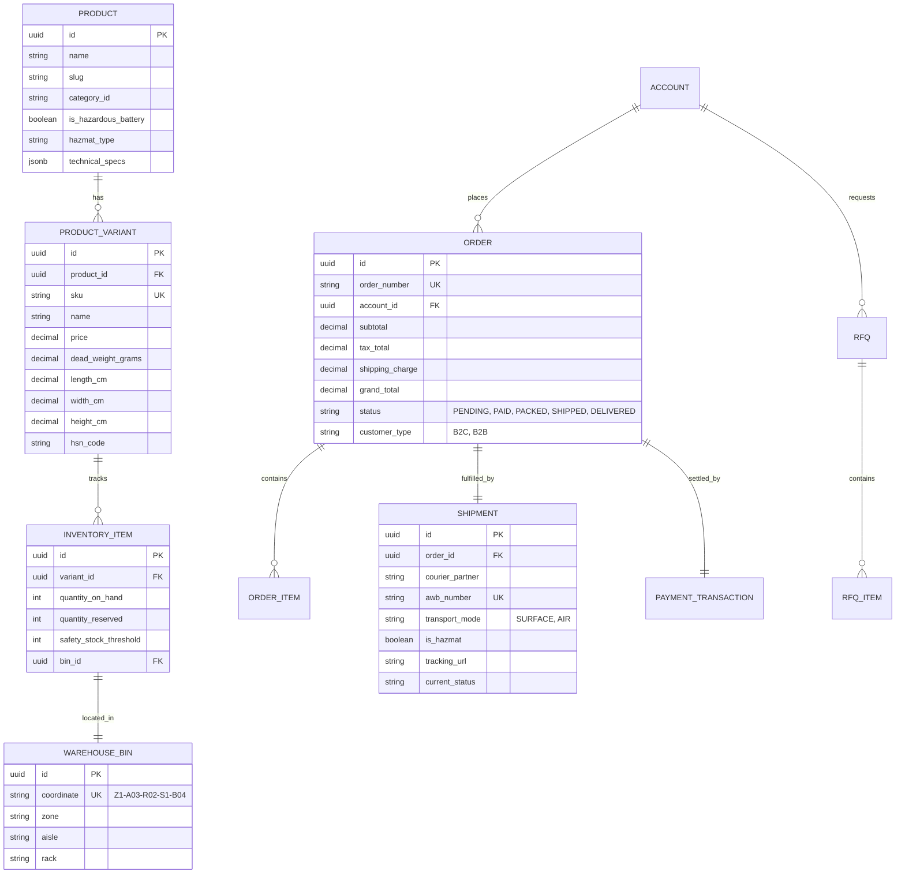
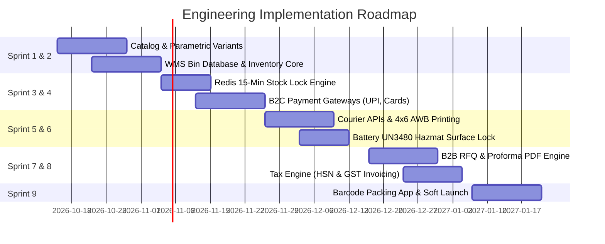

# Product Requirements Document (PRD)
## Robotics Parts & Kits E-Commerce Platform

---

### Document Information
- **Product Title:** Robotics Hardware & Starter Kits Direct-Commerce Platform
- **Version:** 1.0.0
- **Status:** Ready for Engineering Review & Sprint Planning
- **Source BRD:** [Robotics_Ecommerce_BRD.md (v2.0)](./Robotics_Ecommerce_BRD.md)
- **Target Market:** Domestic / Regional Market
- **Date:** October 12, 2026

---

## 1. Product Vision & Success Metrics

### 1.1 Product Vision
To build the fastest, most reliable hardware procurement platform for robotics developers by combining **verified direct warehouse inventory**, **frictionless parametric component selection**, and a **hybrid checkout engine** that serves both rapid consumer hobbyist purchases and formal institutional B2B procurement workflows.

### 1.2 North Star Metric & Key Performance Indicators
- **North Star Metric:** *Successful 24-Hour Fulfilled Order Velocity* (Total orders placed, paid, verified, and handed to couriers within 24 hours).
- **Core Product Metrics:**
  - **Cart-to-Checkout Conversion Rate:** $\ge 68\%$ for retail users.
  - **RFQ-to-Order Conversion Rate:** $\ge 30\%$ for institutional accounts.
  - **Inventory Reservation Drift:** $0\%$ overselling occurrences (verified by automated zero-stock checks).
  - **Battery Logistics Compliance:** $100\%$ compliance with UN3480/UN3481 surface routing (zero parcels rejected at air cargo hubs).
  - **NDR Recovery Rate:** $\ge 45\%$ of undelivered attempts converted to successful delivery via automated WhatsApp/SMS address confirmation.

---

## 2. User Journeys & Experience Architecture

### 2.1 B2C Maker Journey (Instant Purchase)


### 2.2 B2B Institutional Journey (Quote & Purchase Order)


---

## 3. Epics & Functional Specifications



---

### Epic 1: Catalog, Parametric Search & Product Detail Page (PDP)

#### User Story 1.1: Parametric Component Variant Selector
- **As a** robotics builder,
- **I want to** select motor RPM, operating voltage, or sensor range directly on the product page,
- **So that** I get the exact mechanical and electrical fit for my robot without navigating multiple disconnected product listings.

##### Acceptance Criteria
- [ ] **AC-1.1.1:** Variant attributes (e.g., `Voltage: [6V, 12V, 24V]`, `RPM: [60, 100, 300, 600]`, `Shaft: [4mm D-cut, 6mm Keyway]`) render as interactive selector chips.
- [ ] **AC-1.1.2:** Changing any attribute triggers an immediate client-side update of the SKU, Price, Available Warehouse Quantity, and Parametric Spec Table within $< 150\text{ ms}$.
- [ ] **AC-1.1.3:** If a specific combination has 0 inventory, the chip remains selectable but displays an "Out of Stock" badge and disables the "Add to Cart" button.

#### User Story 1.2: Standardized Engineering Specification Table
- **As a** hardware engineer,
- **I want to** view standardized technical parameters in a structured table on every product page,
- **So that** I can calculate power budgets, motor sizing, and mechanical tolerances.

##### Acceptance Criteria
- [ ] **AC-1.2.1:** Standard fields are mandatory based on category:
  - *Motors:* Rated Voltage, Stall Torque, Stall Current, No-Load RPM, No-Load Current, Shaft Diameter, Weight.
  - *Drivers:* Operating Voltage, Continuous Current/Channel, Peak Current, PWM Frequency, Logic Level.
  - *Batteries:* Nominal Voltage, Capacity (mAh), Discharge Rate (C-Rating), Watt-Hours (Wh), Dimensions, Connector Type.
- [ ] **AC-1.2.2:** Display a downloadable PDF datasheet link (if provided in catalog metadata).

#### User Story 1.3: Starter Kit "What's in the Box" Bill of Materials
- **As a** STEM student or hobbyist,
- **I want to** see an itemized checklist of all parts included in a bundle,
- **So that** I know whether tools, batteries, or screws are included before purchasing.

##### Acceptance Criteria
- [ ] **AC-1.3.1:** Kit PDP displays a dedicated section titled "What's in the Box".
- [ ] **AC-1.3.2:** Each line item displays: Component Name, Thumbnail, Included Quantity, and a clickable link to that component's standalone spare-part page.

---

### Epic 2: Direct Inventory & Warehouse Management System (WMS)

#### User Story 2.1: Real-Time Stock Reservation & Concurrency Lock
- **As a** shopper during high-demand releases,
- **I want my** cart items reserved while I complete payment,
- **So that** another user cannot purchase the last item from under me during the gateway transition.

##### Acceptance Criteria
- [ ] **AC-2.1.1:** When the customer clicks "Proceed to Payment", the system creates a Redis distributed lock for each line item (`lock:sku:{sku_id}`) with a **15-minute Time-To-Live (TTL)**.
- [ ] **AC-2.1.2:** The available stock counter displayed to other shoppers decrements by the reserved quantity immediately.
- [ ] **AC-2.1.3:** If the payment succeeds, the temporary lock converts into a permanent database stock deduction.
- [ ] **AC-2.1.4:** If the payment fails or the 15-minute timer expires without payment webhook confirmation, the Redis lock automatically deletes and returns the units to available stock.

#### User Story 2.2: Warehouse Bin Coordinate Mapping & Pick-List Routing
- **As a** warehouse fulfillment picker,
- **I want** generated pick lists sorted by physical warehouse aisle and bin sequence,
- **So that** I can pick multiple orders in a single, non-overlapping walking path.

##### Acceptance Criteria
- [ ] **AC-2.2.1:** Every physical item record contains a required bin coordinate string: `Zone-Aisle-Rack-Shelf-Bin` (e.g., `Z1-A02-R04-S2-B01`).
- [ ] **AC-2.2.2:** Warehouse admin can trigger "Generate Batch Pick-List" for all orders marked `READY_TO_PICK`.
- [ ] **AC-2.2.3:** The generated list sorts SKUs sequentially by Aisle $\rightarrow$ Rack $\rightarrow$ Shelf.

#### User Story 2.3: Barcode Scan Verification at Packing Station
- **As a** packing station operator,
- **I want to** scan the barcode of every item before sealing the parcel,
- **So that** the system flags wrong variants (e.g., 100 RPM motor scanned instead of 300 RPM) before shipment.

##### Acceptance Criteria
- [ ] **AC-2.3.1:** The packing screen displays the expected SKUs for the selected Order ID.
- [ ] **AC-2.3.2:** Scanning a matching SKU barcode turns its row green and increments the scanned count.
- [ ] **AC-2.3.3:** Scanning an incorrect SKU triggers an audible warning tone and displays a prominent red modal: `"WRONG ITEM: Expected SKU [X], Scanned [Y]"`.
- [ ] **AC-2.3.4:** The shipping label cannot be printed until 100% of the line items match the order manifest.

---

### Epic 3: Payments & Financial Checkout Workflows

#### User Story 3.1: Consumer Instant Payment Gateways (UPI & 3DS Cards)
- **As a** retail customer,
- **I want to** pay using instant UPI Intent on mobile or scan a dynamic QR on desktop,
- **So that** my order is confirmed instantly without typing card numbers.

##### Acceptance Criteria
- [ ] **AC-3.1.1:** Desktop checkout renders an instant Dynamic UPI QR code preloaded with the exact payable amount and order reference.
- [ ] **AC-3.1.2:** Mobile checkout surfaces native UPI Intent options (Google Pay, PhonePe, Paytm, BHIM, Cred).
- [ ] **AC-3.1.3:** Domestic Credit and Debit card checkout enforces 3D-Secure 2.0 OTP verification and stores card credentials strictly via RBI/PCI-compliant network tokenization.

#### User Story 3.2: Asynchronous Webhook Idempotency & Reconciliation
- **As the** platform accounting system,
- **I want** payment processing to handle dropped connections and duplicate webhooks safely,
- **So that** orders are never missed and customers are never charged twice.

##### Acceptance Criteria
- [ ] **AC-3.2.1:** All gateway callbacks verify HMAC-SHA256 signatures using the secret merchant key.
- [ ] **AC-3.2.2:** Every incoming webhook checks the database table `payment_transactions` for the unique `gateway_transaction_id`. If already processed (`STATUS: CAPTURED`), the webhook returns HTTP 200 immediately without executing business logic twice.
- [ ] **AC-3.2.3:** If the browser connection drops during 3DS redirection, the server-to-server webhook independently transitions the order from `PAYMENT_PENDING` to `ORDER_CONFIRMED`.

#### User Story 3.3: B2B Request for Quote (RFQ) & Formal Proforma Generation
- **As a** university lab purchaser,
- **I want to** generate a formal quotation PDF from my shopping cart,
- **So that** I can submit it to the accounts department for grant approval before payment.

##### Acceptance Criteria
- [ ] **AC-3.3.1:** For carts containing $\ge 10$ units or value $\ge \$250$, checkout displays the button: `"Generate Proforma Quote (RFQ)"`.
- [ ] **AC-3.3.2:** Clicking the button creates an RFQ record and generates a signed PDF containing:
  - System Quote ID (e.g., `RFQ-2026-1049`)
  - 14-day price lock guarantee timestamp
  - Itemized HSN codes, unit prices, tax breakdown (CGST/SGST/IGST)
  - Bank NEFT/RTGS wire transfer details
- [ ] **AC-3.3.3:** B2B portal allows the buyer to upload an authorized Purchase Order (PO) PDF against the Quote ID at a later date.

#### User Story 3.4: Statutory Tax Engine & HSN Invoicing
- **As a** registered corporate buyer,
- **I want** my GSTIN and company details validated during checkout,
- **So that** I receive a valid tax invoice eligible for input tax credit.

##### Acceptance Criteria
- [ ] **AC-3.4.1:** Checkout accepts optional B2B GSTIN input; validates format via regex and verifies active status via tax API.
- [ ] **AC-3.4.2:** Each SKU applies its mandated HSN code:
  - `8501`: Electric Motors & Actuators
  - `8542`: Microcontrollers & ICs
  - `8504`: Power Supplies & Voltage Regulators
  - `8507`: Lithium Batteries & Accumulators
- [ ] **AC-3.4.3:** Automatically computes Intrastate tax (CGST + SGST) if shipping state matches warehouse state, or Interstate tax (IGST) if states differ.

---

### Epic 4: Logistics, Rate Engine & Hazardous Battery Compliance

#### User Story 4.1: Hazardous Battery Transport Compliance (UN3480 / UN3481)
- **As the** logistics operations manager,
- **I want** the system to enforce ground-only surface shipping whenever a cart contains Lithium batteries,
- **So that** packages comply with aviation safety regulations and are never impounded at air cargo terminals.

##### Acceptance Criteria
- [ ] **AC-4.1.1:** Every product in the database contains a boolean flag `is_hazardous_battery` and a category enum `[NONE, UN3480_STANDALONE, UN3481_IN_EQUIPMENT]`.
- [ ] **AC-4.1.2:** If any item in the cart has `is_hazardous_battery == true`:
  - The shipping rate calculator automatically **hides and disables all Air Express courier options**.
  - Only **Surface Logistics (Ground Transport)** options are presented to the user.
  - A prominent notice displays: *"Contains Lithium Battery (UN3480/3481) - Dispatched via ground transport to comply with safety regulations."*
- [ ] **AC-4.1.3:** The thermal packing label automatically prints a certified Lithium Battery Hazard warning mark with required 24/7 emergency contact details.

#### User Story 4.2: Volumetric Weight & Packaging Rate Calculator
- **As the** finance manager,
- **I want** courier shipping charges calculated using volumetric weight vs. dead weight,
- **So that** oversized lightweight items (like robot chassis plates and wheels) do not cause shipping margin losses.

##### Acceptance Criteria
- [ ] **AC-4.2.1:** Every SKU stores physical package dimensions: length ($L$), width ($W$), height ($H$) in centimeters, and dead weight ($M$) in grams.
- [ ] **AC-4.2.2:** Billable weight is computed using the standard courier volumetric formula:
  $$W_{\text{billable}} = \max\left(M, \; \frac{L \times W \times H}{5000} \times 1000\right)$$
- [ ] **AC-4.2.3:** Carrier rate API receives the computed billable weight and returns accurate shipping quotes dynamically at checkout.

#### User Story 4.3: Automated AWB Generation & 2:00 PM Same-Day SLA
- **As a** warehouse operator,
- **I want** courier AWB barcodes and shipping labels generated with a single click,
- **So that** orders can be packed and handed to pickup couriers before daily cutoff.

##### Acceptance Criteria
- [ ] **AC-4.3.1:** Orders paid before 2:00 PM on business days receive a visual `SAME_DAY_DISPATCH` badge in the warehouse packing queue.
- [ ] **AC-4.3.2:** Packing operator clicks "Generate Label" $\rightarrow$ System calls courier API $\rightarrow$ Returns Air Waybill number (AWB) and renders a standard 4x6 inch thermal PDF label.
- [ ] **AC-4.3.3:** Order status transitions to `MANIFESTED` and sends the tracking link to the customer.

#### User Story 4.4: Automated NDR (Non-Delivery Report) Resolution
- **As a** customer whose delivery attempt failed,
- **I want** to receive an immediate WhatsApp/SMS message to correct my address or reschedule,
- **So that** my parcel is not prematurely returned to the warehouse.

##### Acceptance Criteria
- [ ] **AC-4.4.1:** When courier webhook returns `STATUS: UNDELIVERED` (reason: address not found / customer unavailable), system triggers an automated interactive WhatsApp/SMS alert within 15 minutes.
- [ ] **AC-4.4.2:** Message provides interactive options:
  - `[Confirm Address / Add Landmark]`
  - `[Reschedule for Tomorrow]`
- [ ] **AC-4.4.3:** Customer response is submitted via API back to the courier partner for the subsequent delivery attempt.

---

### Epic 5: Customer Account, RMA & 7-Day DOA Return Policy

#### User Story 5.1: 7-Day Dead on Arrival (DOA) Technical RMA Ticket
- **As a** customer who received a defective microcontroller or motor driver,
- **I want to** submit a Return Merchandise Authorization (RMA) ticket with wiring photos,
- **So that** the engineering team can verify the issue and approve a replacement quickly.

##### Acceptance Criteria
- [ ] **AC-5.1.1:** Return requests can only be initiated within **7 calendar days** of the courier `DELIVERED` milestone timestamp.
- [ ] **AC-5.1.2:** RMA submission form requires:
  - Return Reason: `[Dead on Arrival, Damaged in Transit, Missing Part, Wrong Item Received]`
  - Mandatory upload of at least 1 clear photo showing wiring/solder connections.
  - Optional short video link showing the power-up test failure.
- [ ] **AC-5.1.3:** Once submitted, ticket routes to the technical support queue. Upon approval:
  - System generates a reverse courier pickup label.
  - Automatically dispatches replacement unit or issues store credit refund.

---

## 4. Data Models & API Specifications

### 4.1 Core Entity Schemas



---

### 4.2 Key API Contracts

#### Endpoint 1: Pincode Serviceability & Hazmat Rate Check
- **Route:** `POST /api/v1/logistics/serviceability`
- **Request Payload:**
```json
{
  "destination_pincode": "560001",
  "items": [
    { "variant_id": "v-101", "quantity": 2 },
    { "variant_id": "v-205", "quantity": 1 }
  ]
}
```
- **Response Payload (200 OK):**
```json
{
  "serviceable": true,
  "contains_hazmat_battery": true,
  "enforced_transport_mode": "SURFACE",
  "available_couriers": [
    {
      "courier_code": "DELHIVERY_SURFACE",
      "courier_name": "Delhivery Surface (Battery Compliant)",
      "estimated_days": 3,
      "estimated_delivery_date": "2026-10-15",
      "rate": 120.00
    }
  ],
  "air_express_blocked_reason": "Cart contains UN3480 Lithium Battery. Surface transit mandatory."
}
```

---

#### Endpoint 2: Payment Webhook Ingestion (Idempotent)
- **Route:** `POST /api/v1/payments/webhooks/gateway-callback`
- **Headers:** `X-Gateway-Signature: sha256_hash_value`
- **Request Payload:**
```json
{
  "event": "payment.captured",
  "gateway_transaction_id": "pay_Oid9834Khj2",
  "order_session_id": "sess_897123",
  "amount_in_cents": 245000,
  "currency": "INR",
  "method": "upi",
  "upi_vpa": "customer@okaxis",
  "created_at": 1791823900
}
```
- **Response Payload (200 OK):**
```json
{
  "status": "PROCESSED",
  "order_number": "ORD-2026-9812",
  "stock_lock_status": "CONVERTED_TO_PERMANENT_DEDUCTION"
}
```

---

## 5. UI/UX States & Edge Cases

| Screen / Component | Edge Case Scenario | Required UI/UX Behavior |
| :--- | :--- | :--- |
| **Product Detail Page** | Item has only 1 unit remaining | Display alert badge: `⚠️ Only 1 Left in Stock - Order Soon` to encourage quick conversion. |
| **Product Detail Page** | Selected variant has 0 stock | Selector chip shows disabled styling; Primary CTA switches to `Out of Stock` with an optional `Notify Me When Available` modal. |
| **Cart / Checkout** | Cart contains LiPo / Li-Ion Battery | Sticky banner at top of cart: `🔋 Battery Shipping Notice: Dispatched via certified ground logistics.` Air options hidden at checkout. |
| **Checkout - Payment** | Gateway window opens | Display 15-minute countdown timer: `Stock reserved for 14:59`. If countdown hits zero, modal closes with message: `Reservation expired. Please review your cart.` |
| **Checkout - Serviceability**| Remote pincode not serviced by courier | Inline error below pincode input: `Sorry, we cannot currently ship to this pincode. Please try another address or contact support.` CTA disabled. |
| **Warehouse Packing** | Picker scans incorrect variant barcode | Fullscreen red warning dialog with high-priority audio alert. Label printing disabled until barcode is cleared. |

---

## 6. Telemetry & Analytics Event Schema

To evaluate the product against our KPIs, the front-end and back-end must dispatch the following structured telemetry events:

| Event Name | Trigger Condition | Key Event Properties |
| :--- | :--- | :--- |
| `pdp_variant_selected` | User clicks an attribute chip | `product_id`, `sku`, `price`, `stock_available`, `voltage`, `rpm` |
| `hazmat_notice_viewed` | User views cart with battery SKU | `cart_value`, `battery_sku_list`, `enforced_mode: SURFACE` |
| `checkout_stock_locked` | User enters payment step | `order_session_id`, `reserved_sku_list`, `lock_ttl_seconds: 900` |
| `payment_completed` | Payment webhook processed | `order_number`, `method: UPI/Card/NetBanking`, `amount`, `customer_type` |
| `rfq_generated` | B2B user downloads proforma | `rfq_id`, `account_id`, `company_name`, `total_amount`, `item_count` |
| `order_dispatched` | Courier scans parcel manifest | `order_number`, `awb_number`, `courier_partner`, `lead_time_hours` |
| `ndr_triggered` | Courier attempt fails | `order_number`, `awb_number`, `reason_code`, `attempt_number` |
| `rma_submitted` | Customer files return ticket | `order_number`, `sku`, `reason`, `has_photo: true`, `has_video: boolean` |

---

## 7. Sprint Phasing & Release Plan



---

## 8. Sign-Off & Approvals

| Stakeholder Role | Name | Status | Date |
| :--- | :--- | :--- | :--- |
| **Product Manager** | Lead PM | Ready for Sprint | Oct 12, 2026 |
| **Lead Architect** | Technical Lead | Architecture Approved | Oct 12, 2026 |
| **Engineering Lead** | Backend / Full-Stack Lead | Sprint Sizing Complete | Oct 12, 2026 |
| **QA / Testing Lead** | QA Lead | Test Plan Baseline Ready | Oct 12, 2026 |
